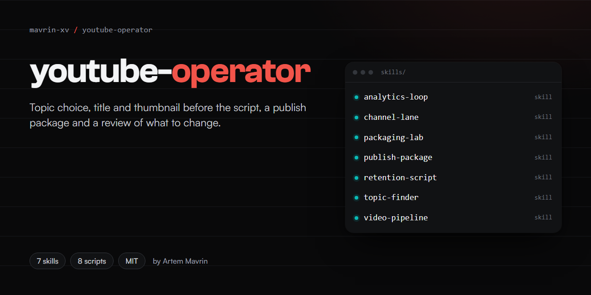

# youtube-operator

**Runs the business side of a YouTube channel for your AI agent: what to make next, the title and thumbnail before the script, a script that holds viewers, a publish package that passes YouTube's limits, and a review that says what to change.**

Most channels guess. They pick topics from a hunch, write the script first and find a title afterwards, ship broken chapters, then stare at a CTR number with no baseline and change three things at once.

[](LICENSE)


```bash
git clone https://github.com/mavrin-xv/youtube-operator && cd youtube-operator
./install.sh                 # or: ./install.sh --project
```

<!-- install-notes:start -->
Other ways in: as a Claude Code plugin, run `/plugin marketplace add mavrin-xv/youtube-operator` and then `/plugin install youtube-operator@youtube-operator`. For Codex or another agent that reads `SKILL.md`, copy the folders under `skills/` into its skills directory. On Windows, run `install.sh` from Git Bash or WSL and type `py -3` where these docs say `python3`.
<!-- install-notes:end -->

Then tell your agent: `find outliers on @channel1,@channel2` or `score these titles: ...` or paste your Studio numbers and say `review this video`.

---

## What it solves

| Pain | What the pack does |
|---|---|
| "What should I make next?" | `outlier_finder.py` finds videos that beat their own channel's median by 3x or more; `comment_questions.py` groups the questions viewers ask; `topic_score.py` ranks candidates on a weighted matrix with gates |
| The title gets written last, in a hurry | `packaging-lab` writes three package concepts before any script, runs truth, phone and stranger tests, and `title_score.py` lints every draft |
| Viewers leave in the first 30 seconds | `retention-script` makes the opening confirm the package, plans resets, places the payoff before the midpoint; `script_lint.py` flags throat-clearing, weak transitions and long sentences |
| Chapters silently do not show, a placeholder ships | `publish_lint.py` checks title, description, tags, hashtags, chapters and thumbnail size against YouTube's limits |
| "My CTR is 3%, is that bad?" | `video_review.py` compares each traffic source with your own baseline, prints a 95% range, and diagnoses packaging, delivery or topic |
| Changing everything at once | Review windows (2 h, 48 h, 7 d, 28 d) allow one change at a time, logged in a decision journal |

## What's inside

| Skill | What it does | What to say |
|---|---|---|
| `video-pipeline` | One video card, six gates, routes each stage to the right skill | "plan my next video", "where is this video stuck" |
| `channel-lane` | Channel card (one viewer, one outcome, one lane) and an audit of your last 15 uploads | "what should my channel be about", "audit my channel" |
| `topic-finder` | Outliers on neighbour channels, comment questions, a priority score | "what should I make next", "find outliers on @a,@b" |
| `packaging-lab` | Title and thumbnail before the script, a thumbnail A/B checklist, title scoring | "title and thumbnail for this", "which title is better" |
| `retention-script` | Structures, the first 30 seconds, a claims register, a script linter | "write the script", "check my script" |
| `publish-package` | Description, chapters, tags, end screen, disclosure, a linter and a checklist | "ready to publish?", "make chapters" |
| `analytics-loop` | Windowed reviews from Studio exports, diagnosis, postmortem, decision journal | "why is my video not doing well", "review this video" |

## Quick start

Every script runs offline on the bundled example channel (an invented woodworking channel):

```bash
python3 skills/packaging-lab/scripts/title_score.py --file examples/data/titles.txt --keyword tabletop --thumb "3 FIXES"
```

```
1. 100/100  Why Your Tabletop Cupped (and 3 Fixes That Work)
2. 100/100  I Fixed a Cupped Walnut Tabletop in 2 Days
3. 90/100  Tabletop Cupped? The Moisture Mistake Behind It
     -10  concrete: no number, price or count
4. 35/100  The ULTIMATE Guide to Wood Movement Nobody Tells You About!!
     -15  front-loaded: 'tabletop' missing
     -20  plain language: bait: ultimate, nobody tells you
     ...
5. FAIL 121 chars, YouTube allows 100  Everything You Need to Know About Wood Movement, ...
```

The full run, from channel audit to the 7-day review, with real output at each step: [examples/walkthrough.md](examples/walkthrough.md).

## How it works

```
channel card (once)            video card (per video)
      |                               |
  [A] lane  -->  [B] topic  -->  [C] package  -->  [D] script  -->  production  -->  [G] publish  -->  [I] review
                   ^                                                 (yours)                          |
                   +----------------------- lessons from the 28-day postmortem -----------------------+
```

Each skill reads the video card, does its stage, writes the result back and checks its gate. Production (filming, editing, animation, voice) is yours; the pack hands it an approved package and script. More in [docs/how-it-works.md](docs/how-it-works.md).

## Configure

| Setting | Where | Default |
|---|---|---|
| `YOUTUBE_API_KEY` | environment; a free YouTube Data API v3 key from Google Cloud ([steps](skills/topic-finder/references/outliers.md)) | not set: scripts work on saved JSON files |
| Speaking rate | `script_lint.py --wpm` | 150, a guess: time one real take and use your own |
| Review sample floor | `video_review.py --min-impressions` | 1,000 |
| Your baselines | a small JSON file, see `examples/data/baseline.json` | none: the review still runs, without a baseline column |
| Outlier window | `outlier_finder.py --days`, `--min-age-days`, `--long-only` | 365 days, skip videos under 14 days old |

Install without the script: copy the folders in `skills/` to `~/.claude/skills/` (or your agent's skills folder).

## Honest limits

- No production. The pack does not film, edit, animate or voice anything.
- Nobody outside a channel can see its CTR or retention. Outliers use public views only, divided by the channel's median. vidIQ and similar tools use their own formulas; this one is simple and documented.
- The YouTube Analytics API does not return impressions or CTR, so the review reads Studio CSV exports that you download by hand.
- `title_score.py` is a lint for obvious mistakes, not a CTR prediction. Test & Compare decides.
- `comment_questions.py` groups by shared words, not meaning. Read the groups.
- The live API paths (`--channels`, `--video`) were written against the documented API but not run during development; every offline path was.
- English only for the word lists (bait words, weak transitions, openers).
- Tested on Windows with Git Bash and Python 3.12. macOS and Linux reports are welcome.

## Credits

- Based on / inspired by vidIQ's Outliers idea, a video's views compared with its channel's usual views: https://support.vidiq.com/en/articles/9660010-outliers (proprietary tool; only the idea is used, the formula here is our own median ratio)
- Based on / inspired by YouTube Help, Test & Compare thumbnails and titles: https://support.google.com/youtube/answer/13861714 (documentation)
- Based on / inspired by YouTube Data API quota costs: https://developers.google.com/youtube/v3/determine_quota_cost (documentation, CC BY 4.0)
- Based on / inspired by YouTube Analytics metrics reference: https://developers.google.com/youtube/analytics/metrics (documentation, CC BY 4.0)
- Based on / inspired by YouTube Help pages on chapters, thumbnails, hashtags and end screens (documentation)
- Based on / inspired by public creator advice on packaging first and retention (Film Booth, the leaked MrBeast production memo); used as opinion, not as data

## Contributing

See [CONTRIBUTING.md](CONTRIBUTING.md). Notes for coding agents are in [AGENTS.md](AGENTS.md).

<!-- author:start -->
## Author

Built and maintained by [Artem Mavrin](https://github.com/mavrin-xv). This repo is one of a set of agent skill packs for marketing and operations work. Each one installs on its own; the full list is in [agent-skill-packs](https://github.com/mavrin-xv/agent-skill-packs). If a pack saved you an afternoon, a star helps other people find it.
<!-- author:end -->

## License

MIT. See [LICENSE](LICENSE).
